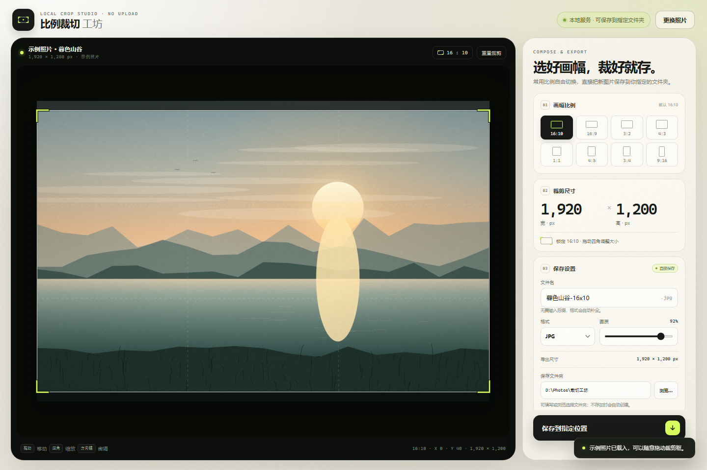

<div align="center">

# 比例裁切工坊

**把照片裁成常用比例，再直接保存到你指定的文件夹。**

默认 16:10 · 支持 8 种画幅 · 本地处理 · 不上传图片

[](https://developer.mozilla.org/docs/Web/HTML)
[](https://developer.mozilla.org/docs/Web/CSS)
[](https://developer.mozilla.org/docs/Web/JavaScript)
[](https://nodejs.org)
[](LICENSE)

</div>



## 简介

比例裁切工坊是一个本地优先的照片裁剪工具。它不依赖后端云服务，也不需要构建步骤：所有图片处理都在浏览器画布中完成，再由本地 Node.js 小服务把结果直接写进你填写的文件夹，而不是丢进浏览器的下载目录。

适合这些场景：

- 把照片裁成 16:10、16:9、4:3、1:1 等固定画幅
- 快速做社交媒体封面、文章题图、头像或竖屏配图
- 希望自己决定文件名、格式和保存位置
- 不希望把照片上传到任何在线修图网站

## 功能特性

- **8 种常用画幅**：16:10（默认）、16:9、3:2、4:3、1:1、4:5、3:4、9:16
- **自由构图**：拖动裁剪框移动，拖拽四角按比例缩放，方向键微调位置
- **本地直接保存**：填写或浏览选择文件夹，保存时直接写入本地文件系统
- **不会覆盖原图**：生成一张全新图片；同名文件会自动添加 `(2)`、`(3)` 等后缀
- **自定义文件名**：支持中文、空格和常见字符，扩展名自动补全
- **三种导出格式**：JPG（默认）、PNG（无损）、WebP，可选画质
- **原图画质**：按照裁剪区域实际像素导出，不是屏幕截图
- **严格比例**：导出尺寸按比例整数倍取整，保存出来的图片像素比例精确
- **纯本地运行**：无第三方前端依赖、无远程请求、图片不上传
- **响应式界面**：桌面、平板、手机浏览器均可使用
- **自带示例图**：没有照片时也能立即体验完整裁剪流程

## 快速开始

### 方式一：Windows 一键启动（推荐）

需要先安装 [Node.js](https://nodejs.org) 18 或更高版本。

1. 下载或克隆本项目到本地。
2. 双击 **`启动裁切工坊.bat`**。
3. 浏览器会自动打开 `http://127.0.0.1:43169`。
4. 保持命令行窗口开启；关闭窗口即可停止本地服务。

这种方式支持：

- 在「保存文件夹」输入框里填写任意绝对路径，例如 `C:\Users\你的名字\Pictures\裁切`
- 点击「浏览…」打开系统文件夹选择窗口
- 文件夹不存在时自动创建
- 保存后点击「打开文件夹」直接定位到成品

### 方式二：命令行启动

```bash
# 进入项目目录后
npm start
```

或者：

```bash
node app-server.js
```

### 方式三：直接打开 HTML

直接双击 `index.html` 也能使用裁剪功能。由于浏览器安全策略，此时无法把输入框里的文字路径映射到真实磁盘路径，但支持：

- 通过系统文件选择器选择保存文件夹（Chromium 浏览器）
- 通过「另存为」窗口直接写入指定位置
- 不支持 File System Access API 的浏览器会自动降级为普通下载

> 如果需要「填写路径 + 直接保存」，请使用 `启动裁切工坊.bat` 或 `npm start` 启动本地服务。

## 使用说明

1. 把照片拖进左侧画布，或点击「选择文件」。
2. 在右侧「画幅比例」里选择目标比例；默认是 **16:10**。
3. 拖动裁剪框内部移动位置，拖动四角缩放大小。
4. 填写文件名，选择格式和画质。
5. 填写或选择保存文件夹。
6. 点击「保存到指定位置」。

其他快捷操作：

- `方向键`：小幅移动裁剪框
- `Shift + 方向键`：大幅移动
- `Ctrl + S` / `Cmd + S`：保存
- 「重置裁剪」：恢复当前比例下最大的取景框

## 支持的画幅

| 比例 | 像素比例 | 常见用途 |
| --- | --- | --- |
| 16:10 | 1.600 | 笔记本屏幕、摄影作品、网页头图（默认） |
| 16:9 | 1.778 | 视频封面、宽屏题图 |
| 3:2 | 1.500 | 相机原生画幅、照片打印 |
| 4:3 | 1.333 | 传统照片、演示文稿 |
| 1:1 | 1.000 | 头像、社交平台方图 |
| 4:5 | 0.800 | Instagram 竖图 |
| 3:4 | 0.750 | 竖版照片、海报 |
| 9:16 | 0.563 | 手机壁纸、短视频竖封面 |

## 保存机制

| 启动方式 | 填写路径 | 浏览文件夹 | 实际保存方式 |
| --- | :---: | :---: | --- |
| `启动裁切工坊.bat` / `npm start` | ✅ | ✅ | 本地服务直接写入文件系统 |
| 直接打开 `index.html` | — | ✅ | File System Access API 写入所选文件夹 |
| 浏览器不支持文件系统 API | — | — | 兼容模式：浏览器下载 |

本地服务只监听 `127.0.0.1`，不会暴露到局域网。保存同名文件时会自动改名，避免误覆盖已有图片。

## 支持的图片

**读取格式**：JPG、PNG、WebP、AVIF、GIF、BMP。GIF 仅取第一帧；HEIC/HEIF 取决于浏览器解码能力。

**导出格式**：JPG、PNG、WebP。

**尺寸限制**：超大图片会自动限制在最长边 8192 px、总计 4000 万像素以内，避免浏览器画布超出限制。

建议使用较新的 Chrome、Edge、Safari 或 Firefox。填写路径并直接写入的完整能力需要 Node.js 本地服务。

## 项目结构

```text
ratio-crop-studio/
├── index.html              # 单文件前端：界面、Canvas 裁剪、导出逻辑
├── app-server.js           # 本地 Node.js 服务：静态页面、文件夹选择、保存 API
├── 启动裁切工坊.bat         # Windows 一键启动器
├── preview.png             # README 界面截图
├── package.json            # npm start 与 Node 版本声明
├── README.md
├── LICENSE
└── .gitignore
```

前端没有构建步骤，也没有 npm 运行时依赖。`app-server.js` 只使用 Node.js 标准库。

## 本地 API

启动本地服务后可使用以下接口：

| 方法 | 路径 | 说明 |
| --- | --- | --- |
| `GET` | `/api/info` | 返回版本、默认保存文件夹和最近保存位置 |
| `POST` | `/api/browse-folder` | 打开系统文件夹选择窗口 |
| `POST` | `/api/save?dir=...&filename=...` | 请求体为图片二进制，直接写入目标文件夹 |
| `POST` | `/api/open-folder` | 在资源管理器中打开成品所在文件夹 |
| `GET` | `/api/health` | 服务健康检查 |

`/api/save` 会校验文件扩展名与图片二进制签名是否一致，并使用临时文件 + 重命名的方式原子写入。

## 隐私与安全

- 图片不会上传到互联网，所有裁剪都在本机浏览器内完成
- 本地服务只绑定 `127.0.0.1`
- API 会校验请求的 `Origin`，拒绝来自其他网站的跨域请求
- 文件名会过滤 Windows 非法字符，避免路径穿越
- 不会修改原图，只创建新文件
- 最近一次保存位置记录在用户目录的 `.ratio-crop-studio.json` 中，可随时删除

## 常见问题

<details>
<summary><strong>为什么直接双击 index.html 不能填写任意路径？</strong></summary>

浏览器出于安全考虑，不允许网页通过文字路径直接写入文件系统。启动项目自带的本地 Node.js 服务后，路径输入框会启用，保存会由本地服务完成。

</details>

<details>
<summary><strong>保存后文件在哪里？</strong></summary>

就在你填写的「保存文件夹」中。保存成功后界面会显示完整路径，点击「打开文件夹」可以直接在资源管理器中定位。

</details>

<details>
<summary><strong>会覆盖同名文件吗？</strong></summary>

不会。遇到同名文件时会自动保存为 `文件名 (2).png`、`文件名 (3).png` 等。

</details>

<details>
<summary><strong>端口 43169 被占用怎么办？</strong></summary>

本地服务会自动尝试后续端口（43170、43171……），并在启动窗口里打印实际地址。通常直接使用自动打开的浏览器页面即可。

</details>

<details>
<summary><strong>支持 HEIC 吗？</strong></summary>

取决于浏览器是否能解码 HEIC。为了兼容性，建议先转换为 JPG 或 PNG。

</details>

## 开发

```bash
# 启动本地服务
npm start

# 仅做语法检查
node --check app-server.js
```

可选环境变量：

| 变量 | 默认值 | 说明 |
| --- | --- | --- |
| `CROP_PORT` | `43169` | 本地服务起始端口 |
| `CROP_NO_OPEN` | — | 设为 `1` 时不自动打开浏览器 |
| `CROP_CONFIG` | `~/.ratio-crop-studio.json` | 自定义配置文件路径 |
| `CROP_TEST_FOLDER` | — | 测试用：让「浏览」直接返回指定文件夹 |

## License

[MIT](LICENSE) © 2026 Ratio Crop Studio contributors
